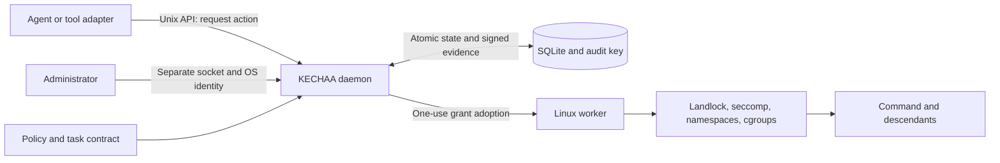
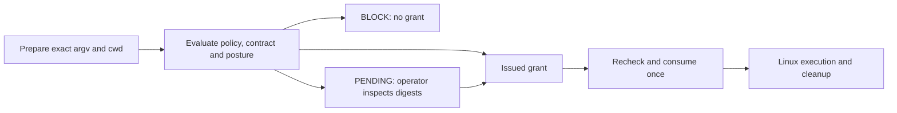

# KECHAA

**Authorization-bound execution for agent tools.**

KECHAA — Kernel-Enforced Containment for Hijacked AI Agents — puts a local authorization daemon between an agent and command execution. It binds each command to a task contract and a single-use signed grant. Its experimental Linux worker applies filesystem, syscall, network and process-lifetime restrictions to that command and its descendants.

**Evaluation alpha, not production-certified.** The diagnostic walkthrough works on macOS and Linux without root. It exercises real policy, Unix IPC, grants and audit records, but executes no agent commands. Current Linux verification gaps are [explicitly tracked](docs/linux-requirements.md).

[Start here](docs/getting-started.md) · [Architecture](docs/architecture.md) · [Security model](docs/security.md) · [Examples](examples/README.md) · [Contribute](CONTRIBUTING.md)

## Try it in five minutes

Prerequisites: Git, Python 3.11+ with `venv`/pip, macOS or Linux, and permission to create local Unix sockets. Use your ordinary user account. Downloading dependencies needs internet access; the demo itself is offline.

```bash
git clone https://github.com/ruchithamohan/KECHAA-Kernel-Enforced-Containment-for-Hijacked-AI-Agents.git
cd KECHAA-Kernel-Enforced-Containment-for-Hijacked-AI-Agents
python3 -m venv .venv
.venv/bin/python -m pip install -r requirements.txt
.venv/bin/python -IS bin/kechaa demo
```

Representative output, abbreviated:

```text
KECHAA diagnostic demo — real Unix API, no command execution
ALLOW            allow        Signed grant consumed with executed=false (simulation).
BLOCK            replay       Consumed grant cannot be reused.
PENDING_APPROVAL approval     No command ran. The disposable operator inspects both grant digests.
BLOCK            destructive  Policy denied the request before execution.
BLOCK            filesystem   Policy denied the request before execution.
ALLOW            mcp          offline declared effects; no MCP server was invoked.
BLOCK            mcp          external declared effects; no MCP server was invoked.
Audit: verified. Cleanup: temporary daemon, keys, state and files removed.
```

The demo creates and stops a real diagnostic daemon in a fresh temporary directory. It uses synthetic data and removes its temporary keys, state and files on exit. `--json` returns machine-readable results. [Individual scenarios and their boundaries](examples/README.md) explain exactly what ran.

For a standalone installation with a pinned interpreter:

```bash
.venv/bin/python -IS tools/install.py install --prefix .local/install
.local/install/bin/kechaa demo
.venv/bin/python -IS tools/install.py verify --prefix .local/install
```

The installer starts no service and makes no PATH changes. Use a new empty prefix; it refuses overwrites. A conventional `pip install kechaa` is **not** the supported CLI installation: the launcher deliberately requires isolated Python startup. [Install, troubleshoot and remove](docs/getting-started.md).

## Why an execution boundary?

An agent can be redirected by repository text, web content or a tool response. A prompt asking it to stay inside a directory does not constrain the operating system. Even a command approval can become stale if its arguments, inputs, policy or session change before execution.

KECHAA addresses that gap with explicit authorization and bounded effects. A grant binds the reviewed command, inputs, identity, policy and expiry; adoption rechecks them and consumes the grant once. Three policy denials persist lockdown until authenticated administrative review. It does not detect every prompt injection or decide whether an authorized action is wise.

Primary users are agent infrastructure engineers evaluating offline command tools and Linux security engineers examining their execution boundary. Useful scenarios include local coding/build tools, approval queues, command replay protection and containment research. Arbitrary remote MCP servers, online agents and database authorization need other controls.

## Architecture





Diagnostics replace the final execution step with explicit simulation. The administrator and daemon are trusted. An adapter cannot approve its own request; a disconnected client cannot recover a consumed grant. [Detailed flow, failure handling and trust boundaries](docs/architecture.md).

## Capabilities and evidence

| Capability | Enforcement location | Current evidence and limit |
|---|---|---|
| Policy/contract intersection, exact-action grants, replay rejection | Python daemon + SQLite transactions | Real Unix API regressions and runnable demo |
| Persistent denial lockdown; authenticated recovery | Daemon state + administrative endpoint | Flooding, concurrency and restart regressions |
| Producer identity in signed audit records | Authenticated endpoint/internal daemon context | Persistence and export verified; no kernel effect collector |
| Project read/write restrictions | Linux Landlock and private mount restrictions | Historical Debian VM observations; current S3 Linux acceptance incomplete |
| Offline network/syscall restrictions | Linux namespaces and seccomp | Implemented; historical VM observations, no online profile |
| Descendant resource limits and termination | Linux cgroups and lifecycle supervision | Implemented; current patch's kernel lifecycle checks not rerun |
| MCP effect declarations | Daemon authorization check | Real API example; no MCP invocation, proxy or remote enforcement |
| Custom Python / function-call tools | Thin Local API adapter | Runnable diagnostic integration; no framework-wide interception claim |

## Integrate a command tool

The [Python client](kechaa/client.py) keeps authorization in the daemon:

```python
from kechaa.client import AgentClient

# An operator has already confirmed this run and prepared the Linux environment.
client = AgentClient('/run/kechaa/agent.sock', run='RUN_ID', session='SESSION')
prepared = client.prepare(['/usr/bin/echo', 'hello'], cwd='/work/project')
if prepared['state'] == 'pending':
    # Surface the grant ID to the operator; do not execute or auto-approve.
    print('PENDING_APPROVAL', prepared['grant'])
else:
    result = client.execute(prepared)
```

This Linux integration snippet needs real run/session identifiers and administrator-prepared roots. For a runnable local version use `demo --scenario agent`. The client also translates a `run_command` function-call message without an SDK or API key. See [adapter development](docs/adapter-development.md), [API reference](docs/api.md), and the [custom agent example](examples/agent_tool.py).

## Security and platform limits

- macOS: diagnostic control plane only. Windows: unsupported. Linux: experimental x86_64/aarch64 backend requiring Landlock ABI 6+, cgroup v2, namespaces, seccomp and a root-owned installation.
- Protected workspace roots must be dedicated ext4/tmpfs filesystems, without bind aliases or nested mounts. Ordinary shared host directories are refused. [Linux prerequisites](docs/linux-requirements.md).
- The host kernel, administrator, runtime dependencies, daemon and signing key are trusted. Same-UID processes are not separate hostile identities.
- Allowed effects can still be harmful. Runtime libraries remain trusted; writable/transitive inputs are not generally frozen. Stdout/stderr are intentional output channels.
- A wrapper protects only submitted actions. Supervised launch exists, but real agent-harness interception and full MCP mediation remain unverified.
- Audit signatures establish integrity, not immutable storage or proof of every attempted effect. Finite audit capacity can be exhausted. Remote SQL semantics and credential management are out of scope.

Read the [threat model](docs/security.md), [S1–S4 remediation report](audit/KECHAA_S1_S4_REMEDIATION_REPORT.md), [current performance methodology](docs/performance.md) and [release gates](docs/release.md) before a pilot. Historical Linux results are not current certification.

## Development and contribution

```bash
.venv/bin/python -m unittest discover -s tests -v
.venv/bin/python tools/check_docs.py
```

The full existing suite uses macOS fixtures; [contribution instructions](CONTRIBUTING.md) give the portable Linux subset and explain skipped kernel probes. CI runs existing tests, demos, documentation links and installation checks. No badge claims a certification result.

Start with a reproducible installation issue, an adapter example or a documented Linux observation. See the [documentation index](docs/README.md), [roadmap](docs/roadmap.md), [changelog](CHANGELOG.md) and [security reporting policy](SECURITY.md).

MIT licensed. [Dependency acknowledgements and provenance](docs/provenance.md).
