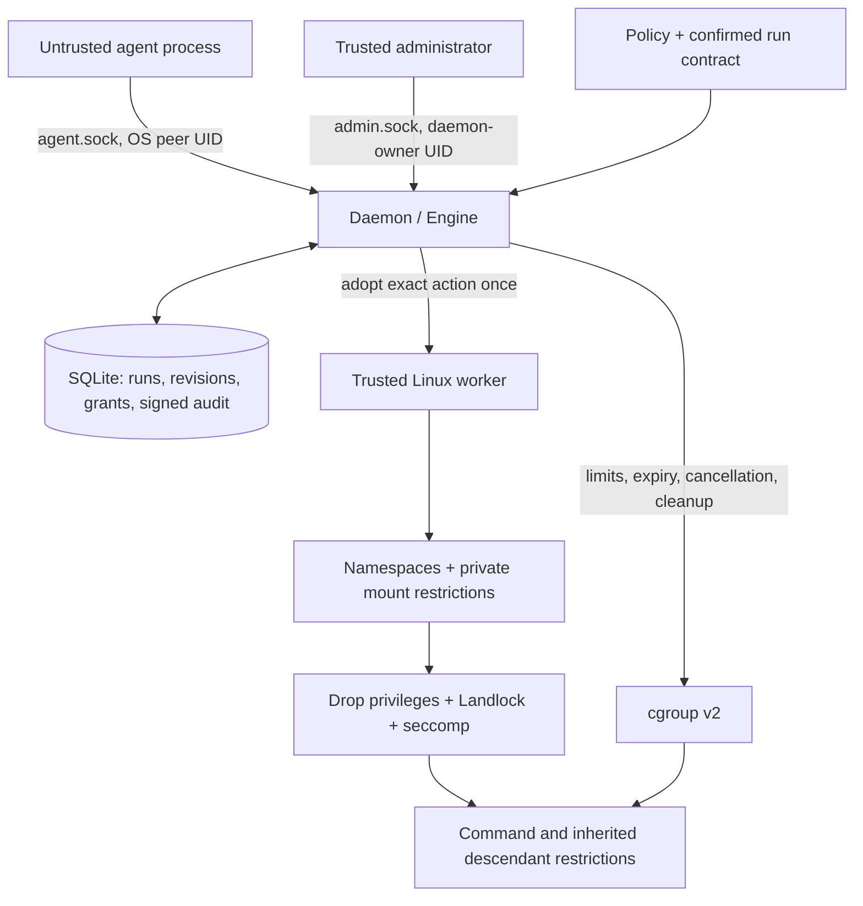

# Architecture and execution boundaries

KECHAA is a local authorization service with an experimental Linux execution worker. The daemon is the authority; a client translates requests. No model output, tool label or adapter is an approver.

## Authorization lifecycle

1. An administrator confirms roots, executable inventory, write permission and lifetime for a run bound to one OS UID/session.
2. `prepare` evaluates policy, contract and persisted posture against exact argv/cwd/inputs. DENY returns no grant; ASK creates pending authority; ALLOW creates issued authority.
3. The daemon identifies executable/input artifacts, narrows effects and signs the grant. An operator approves pending authority only after inspecting action/effect digests.
4. Adoption checks identity, action, inputs, policy, revision, epoch and time, then conditionally consumes the issued grant in a SQLite transaction. Lost responses and reconnects do not restore it.
5. Experimental Linux execution creates a supervised worker and cgroup. The worker installs mandatory restrictions before command entry. Setup failure does not fall back to host execution.
6. Lifecycle completion records the result, verifies cleanup and releases handles. Restart revokes unused authority and reconciles the dedicated action cgroups. Cleanup/audit failure holds admission.

Diagnostics perform steps 1–4 using `simulate` and return `executed:false`; there is no protected command. A successful demo is evidence for control-plane behavior only.

## State, denial and producer identity

Three policy denials since administrative review persist lockdown. Counter, posture/revision, revocation and evidence commit together. Benign history cannot dilute the counter. An exclusive Store lock and synchronous Engine calls serialize state decisions within the daemon. [Remediation details](../audit/KECHAA_S1_S4_REMEDIATION_REPORT.md).

`client_report` comes from the agent endpoint, `admin` from the authenticated administrative endpoint, and internal observations from trusted daemon calls. Clients cannot label themselves kernel producers. No kernel effect stream is shipped; action lifecycle records and declared effects are not a complete syscall trace.

## Source map

| Component | Responsibility |
|---|---|
| [engine.py](../kechaa/engine.py) | Contracts, authorization, grant binding, recovery and posture |
| [policy.py](../kechaa/policy.py) | Strict YAML, capability intersection, precedence |
| [store.py](../kechaa/store.py) | Transactions, signed records, checkpoints and history |
| [daemon.py](../kechaa/daemon.py) | Unix roles, admission and action lifecycle |
| [effects.py](../kechaa/effects.py) | Action normalization, no-follow descriptor walks, artifact identity |
| [linux.py](../kechaa/backends/linux.py) | Kernel prerequisites, worker restrictions and cgroups |
| [client.py](../kechaa/client.py), [protocol.py](../kechaa/protocol.py) | Agent integration and authenticated Unix transport |
| [bootstrap.py](../kechaa/bootstrap.py), [launcher](../bin/kechaa) | Isolated startup and trusted dependency loading |

## What remains trusted

The host kernel, daemon, administrator, signing key, installed interpreter/dependencies and mount administration are trusted. Runtime dependencies disjoint from project roots remain explicitly readable. Same-UID session strings do not isolate hostile processes. A local key holder can replace signed history; independently retain checkpoints to detect rollback. Writable transitive inputs are not frozen by an action digest.

A wrapper only governs requests routed through it. A supervised whole-agent grant is implemented, but end-to-end interception for a real named agent framework remains unverified. See [security](security.md) and [platform requirements](linux-requirements.md) for the full boundary.
